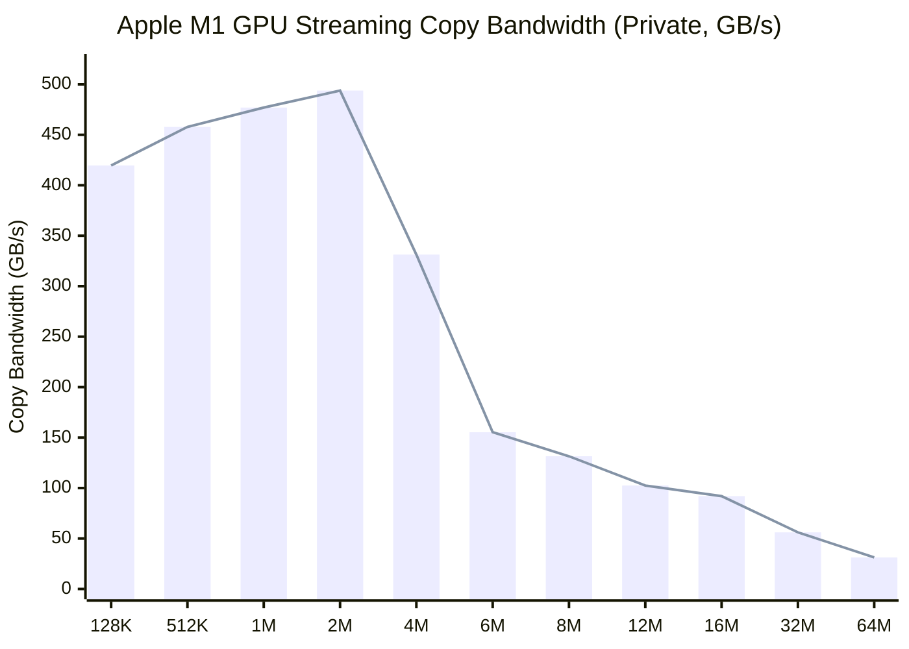

# 01｜Apple M1 矽片物理上限與系統邊界

> 所有數據均實測於本機硬體（可由 [`make -C probes run`](./probes/Makefile) 重現，原始輸出位於 `research/build/m1_probe_results.json`）。本文確立 **BLOOM 純 GPU 引擎（零 `FLOW` 耦合）** 不可逾越的物理邊界。

---

## 1. 本機實測矽片規格總表

| 維度 | 實測數值 / 狀態 | 來源 (`caps` / `sysctl`) | 工程意義 |
| :--- | :--- | :--- | :--- |
| **GPU 架構** | `Apple M1` (`MTLGPUFamilyApple7 = YES`, `Apple8 = NO`) | `MTLDevice` | 7-core AGX TBDR，原生 `SIMD32`，`Metal3 = YES`, `Metal4 = YES` |
| **CPU 核心** | `Apple M1` (`4P + 4E`, 8 threads) | `hw.perflevel0/1` | P-core 128 KB L1D / 12 MB L2；E-core 64 KB L1D / 4 MB L2 |
| **統一記憶體 (UMA)** | `8.00 GB` (`8,589,934,592 B`), `hasUnifiedMemory = YES` | `hw.memsize` | CPU/GPU/Display/ANE 共搶實體容量與 DRAM 頻寬 |
| **系統快取 (SLC)** | `8 MB` (Apple M1 晶片規格，下表實測懸崖精確印證) | `bandwidth_slc` | CPU 與 GPU 唯一共享的片上高速匯流點 |
| **快取行 & 分頁** | `CacheLine = 128 B`, `PageSize = 16,384 B (16 KB)` | `hw.cachelinesize/pagesize` | x86 的 2× cache line 與 4× VM page；原子防偽共享須對齊 128 B |
| **安全工作集上限** | `5,461.3 MB` (`5,726,633,984 B`) | `recommendedMaxWorkingSetSize` | 含 OS 與 App 的 GPU 安全總常駐上限；引擎自身應壓在 `≤ 512 MB` |
| **單一緩衝區上限** | `4,096.0 MB` (`4,294,967,296 B`) | `maxBufferLength` | 實際受制於 8 GB UMA，不應開大於數百 MB 的靜態常駐池 |
| **Threadgroup 上限** | `MaxTG = (1024, 1024, 1024)`, `TGMem = 32 KB` | `MTLDevice` | 滿載 1024 threads/TG 需低 VGPR 壓力；Tile/TG 共享記憶體上限 32 KB |

---

## 2. 頻寬屋頂線：8 MB SLC 懸崖與 LPDDR4X 天花板

透過 [`k_bw_read` / `k_bw_write` / `k_bw_copy`](./probes/m1_silicon_probe.mm) 在完成 GPU DVFS P-State 預熱後，橫掃 `128 KB → 64 MB` 工作集實測結果如下：

| 工作集大小 | `Shared` 讀/寫/拷貝 (`GB/s`) | `Private` 讀/寫/拷貝 (`GB/s`) | `Shared_WC` 讀/寫/拷貝 (`GB/s`) | 物理層區間判斷 |
| :---: | :---: | :---: | :---: | :--- |
| `128 KB` | `178.5` / `223.5` / `419.8` | `178.5` / `223.2` / `419.6` | `178.5` / `223.4` / `419.9` | GPU L2 命中 |
| `1 MB` | `200.7` / `252.8` / `477.4` | `200.8` / `252.8` / `477.0` | `200.7` / `252.8` / `477.0` | **GPU L2 + 8 MB SLC 甜蜜點** |
| **`2 MB`** | `288.8` / **`424.1`** / **`491.4`** | **`289.0`** / **`424.4`** / **`493.8`** | `286.9` / **`424.4`** / `490.7` | **SLC 雙向頻寬峰值 (`~494 GB/s`, 2×2MB=4MB ≤ 8MB)** |
| **`4 MB`** | **`321.4`** / `416.5` / `307.4` | **`318.1`** / `416.2` / `331.3` | **`317.6`** / `405.4` / `323.9` | 讀寫仍全命中 SLC (`Copy = 2×4MB = 8MB` 觸及邊緣) |
| **`6 MB`** | `174.9` / `361.6` / **`162.4`** | `166.4` / `360.6` / **`155.3`** | `171.4` / `353.2` / **`155.8`** | **SLC 懸崖開始 (`Copy 2×6MB=12MB > 8MB`)** |
| **`8 MB`** | `138.1` / `298.8` / `134.0` | `136.4` / `275.5` / `131.5` | `97.9` / `127.0` / `130.2` | **8 MB SLC 飽和臨界點** |
| `12 MB` | `114.1` / `106.6` / `103.5` | `90.1` / `104.9` / `102.5` | `90.5` / `104.5` / `101.5` | 大幅溢出 SLC，回落 DRAM |
| `32 MB` | `67.5` / `75.9` / `55.7` | `66.6` / `75.3` / `56.1` | `66.6` / `63.5` / `59.2` | 逼近 LPDDR4X 上限 |
| **`64 MB`** | **`53.8`** / **`65.6`** / **`40.6`** | **`50.9`** / **`56.5`** / **`31.3`** | **`55.5`** / **`64.7`** / **`32.3`** | **LPDDR4X DRAM 物理地板 (`Copy 2×31–41 = ~63–81 GB/s`)** |

**關鍵物理結論**：
1. **SLC (`≤ 4 MB`) 與 DRAM (`≥ 16–64 MB`) 頻寬落差高達 `6× – 15×`**（Copy 從 `493.8 GB/s` 暴跌至 `31.3 GB/s`；單向 Read 從 `321.4 GB/s` 跌至 `50.9 GB/s`）。
2. **`Private` vs `Shared` 的 raw GPU linear buffer 串流頻寬幾乎相同**；`Private` 真正的壓倒性優勢在 **Texture (`allowGPUOptimizedContents=YES`)** 與 **Render Target 無損壓縮**（見 [02_memory_cache_tbdr.md](./02_memory_cache_tbdr.md)）。
3. **實測發現 DVFS P-State 冷啟動效應**：未預熱時 M1 GPU 從低頻 P-State 起跳，`128 KB–4 MB` 讀寫僅約 `~120 / 202 GB/s`；連續運算 ~150 ms 升頻後才達到 `320 / 494 GB/s`。短時 Burst 渲染若設計不當更容易受制於較低起跳時脈。

---

## 3. 算力屋頂線與 Occupancy 崩潰邊界

實測 `alu_precision`（`262,144` threads, register-resident FMA/ops）與 `caps` PSO Occupancy：

| 核心 / 精度模式 | GPU 中位時間 | 實測算力 / 吞吐 | `maxTotalThreadsPerTG` | 相對 `fp16_lowreg` 倍率 |
| :--- | :---: | :---: | :---: | :---: |
| **`fp16_half4_lowreg`** (4 acc, 低暫存器) | `8.332 ms` | **`2,061.9 GFLOPS`** | `1024` | **`1.00×` (基準)** |
| `fp16_half4_fma` (8 acc, 中暫存器) | `10.283 ms` | `1,670.7 GFLOPS` | `1024` | `0.81×` (-19%) |
| **`fp32_float4_lowreg`** (4 acc) | `9.992 ms` | **`1,719.3 GFLOPS`** | `1024` | `0.83×` |
| `fp32_float4_fma` (8 acc, 高暫存器壓力) | `17.879 ms` | **`960.9 GFLOPS`** | `1024` | `0.47×` (**-44% vs lowreg!**) |
| **`u32_uint4_mad`** | `30.602 ms` | **`561.4 GOPS`** | `1024` | `0.27×` (**慢 3.67×**) |
| **`u64_emulated_uint2`** (`lo/hi uint2`) | `10.021 ms` | **`107.1 G_u64_OPS`** | `1024` | `0.052×` (**慢 19.2×**) |
| **`high_reg_megakernel`** (24×`float4` live) | — | — | **`448` (Occupancy 崩跌 56%)** | 直接觸發與歸檔 `v9` 同級的佔用率上限 (`384–448`) |

**架構含義**：
* **暫存器比想像更致命**：同為 `fp32`，從 8 組 live 向量 (`40+` VGPR) 降到 4 組 (`lowreg`)，實測吞吐直接從 `960.9` 暴增到 **`1,719.3 GFLOPS` (`+79%`)**。這證明為什麼必須拆出極短特化 Shader，嚴禁 Megashader。
* **為什麼 GPU 不該直接跑 `FLOW` 的 64-bit 整數核心**：M1 GPU 上 `fp16` 達 `2,061.9 GFLOPS`，而 32-bit 整數乘加僅 `561.4 GOPS`，模擬 64-bit (`uint2` carry) 更跌到 **`107.1 G_u64_OPS`（慢 `19.2×`）**。讓純 GPU 引擎完全脫離 `FLOW` 64-bit `Cell64` 是物理必然。

---

## 4. 延遲邊界：提交牆、Ring Buffer 與 Zero-Copy 臨界點

| 測試項目 | 實測數據 (`cpu_gpu_sync`) | 物理原因與系統限制 |
| :--- | :--- | :--- |
| Empty CommandBuffer (`commit`+`wait`) | **`63.4 µs`** (p95 `98.9 µs`, GPU `0.1 µs`) | 純 Metal/IOKit 送單往返固定成本 |
| 1-Threadgroup CommandBuffer | **`225.8 µs`** (p95 `262.9 µs`, GPU `5.2 µs`) | **GPU 電源閘控喚醒 + 排程 + IRQ 完成中斷約 ~220 µs** |
| Serial Sync (`60` 幀小 Compute) | `330.9 µs/frame` (`3,022 fps`) | CPU 傻等 GPU 排空 |
| **Triple-Buffered Async (`sem=3`)** | **`154.7 µs/frame` (`6,463 fps`), CPU encode=`21.5 µs`** | 交疊 CPU 與 GPU，實質吃掉 `~2.1×` 同步牆 |
| `16 KB` 上傳：`NoCopy` vs `WC_Ring memcpy` | `NoCopy wrap=6.54 µs` (`e2e=257.4 µs`) vs **`memcpy=0.50 µs`** (`e2e=252.9 µs`) | 16 KB `posix_memalign` + `newBufferWithBytesNoCopy` 驅動釘頁比進常駐 Ring 慢 **`13×`** |
| `64 KB` 上傳：`NoCopy` vs `WC_Ring memcpy` | `NoCopy wrap=6.12 µs` vs **`memcpy=1.46 µs`** | `WC_Ring memcpy` 仍快 `4.2×` |
| `1024 KB` 上傳：`NoCopy` vs `WC_Ring memcpy` | **`NoCopy wrap=6.46 µs`** vs `memcpy=26.54 µs` | **`~256 KB` 才是臨界點**；大資產適合獨立上傳，小於 256 KB 的每幀 UI 原語全寫常駐 WC Ring 最快 |

---

## 5. 4K 60 Hz / 120 Hz 硬體預算公式

以本機 M1 實測 DRAM 地板（雙向 Copy 實效約 `~62–68 GB/s` 系統總量）與 4K (`3840 × 2160 = 8,294,400 px`) 計算：

1. **單幀時間上限**：
   - `60 FPS` 全系統預算：$\le 16.67\text{ ms}$（扣除 Display Scanout / OS Compositor / CPU 前端安全餘裕，GPU 渲染預算應壓在 **`≤ 8–10 ms`**，純 UI 應 **`≤ 1.5 ms`**）。
   - `120 FPS` (外接高刷) 預算：$\le 8.33\text{ ms}$（純 UI 應 **`≤ 1.0 ms`**）。
2. **單幀 DRAM 總流量安全上限（含 Display Scanout）**：
   - M1 Display Engine 掃描單張 4K `BGRA8` (`33.18 MB`) 在 `60 Hz` 約佔 `2.0 GB/s`，`120 Hz` 約 `4.0 GB/s`。
   - 若要求 GPU 在 `120 Hz` 不跨過功耗與頻寬紅線（取系統可用 `50 GB/s` 的一半作安全餘裕 `25 GB/s`）：
     $$\text{DRAM Budget per Frame (120 Hz)} \approx \frac{25\text{ GB/s}}{120\text{ s}^{-1}} \approx \mathbf{208\text{ MB / frame}}$$
   - 單看歸檔 `v9` 的 `RGBA16F` (`66.36 MB`) 全螢幕 Compute 寫入 + 讀出 tonemap (`132.7 MB`) + shadow/backdrop/blit，一幀光全螢幕貼圖來回就吃掉 **`200+ MB` DRAM**；而 TBDR + `framebufferOnly=YES` + `Memoryless` 深度把中間色彩與深度全鎖在片上 Tile Memory，最終 **只對 DRAM 寫出一次無損壓縮後的 `33.18 MB` Swapchain**。
3. **8 GB 統一記憶體常駐安全配額**：
   - 雖然 `recommendedMaxWorkingSetSize = 5,461.3 MB`，扣除 macOS、瀏覽器與 IDE 常駐後，BLOOM 引擎本身常駐資源（字體 Atlas、Shadow/Gradient Lookup、Swapchain、Triple-Buf Rings、Transient Heap）目標應控制在 **`64–256 MB` (UI) / `≤ 512 MB` (3D)**。
