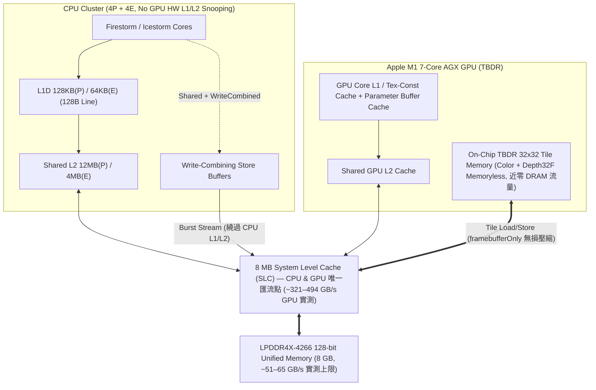

# 02｜記憶體階層、快取物理與 TBDR 架構

> 在 Apple M1 上，渲染速度的本質就是**「把資料留在哪一層快取、能不能進 TBDR Tile Memory、以及有沒有觸發無損壓縮與 Swizzle」**。

---

## 1. Apple M1 記憶體與快取拓樸

### 非硬體一致性的同步模型
* CPU 與 GPU **不會在 L1/L2 之間做硬體 Cache Snooping**。
* CPU 在 `Shared` buffer 寫入的資料，直到呼叫 `[commandBuffer commit]` 的當下，Metal 驅動才會確保寫入資料對該次編碼的 GPU 工作可見；同理，GPU 寫完的結果要等到 Command Buffer 進入 `Completed`（`waitUntilCompleted` 或 completion handler）後才保證對 CPU 可見。
* **鐵律**：絕對不可在 CPU 與 GPU 同時對同一個緩衝區槽位讀寫；高頻更新必須走 **Triple-Buffered Ring（每幀推進固定槽位 `(frame_idx % 3)`）**，見 [`04_transfer_and_pipeline_order.md`](./04_transfer_and_pipeline_order.md)。

---

## 2. 四大 Metal 儲存模式實測對決矩陣

### 實測 CPU 端頻寬陷阱（`16 MB` Shared Buffer）

| 儲存模式 | CPU 循序寫入 (`memcpy`) | CPU 循序讀取 | CPU 512K 隨機 8B 寫入 | 工程解讀 |
| :--- | :---: | :---: | :---: | :--- |
| `Shared + DefaultCache` | `29.05 GB/s` | **`30.62 GB/s`** | `1,592.5 µs` | 寫入需觸發 128B Cacheline RFO，但 CPU 可高速回讀 |
| **`Shared + WriteCombined`** | **`32.81 GB/s`** | **`0.33 GB/s` (暴跌 `93×`!)** | **`613.0 µs` (`2.6×` 快)** | 繞過 CPU L1/L2、無 RFO 懲罰；**但 CPU 一旦讀取 WC 直接掉進未快取地獄！** |

> **血淚規則**：`Shared + WriteCombined` **嚴禁 CPU 回讀、嚴禁 `+=` / 位元遮罩讀改寫、嚴禁只寫 struct 中一半欄位！** 所有實例資料必須在普通系統 RAM/暫存陣列算完，再整筆循序寫入 WC Ring Buffer。

### 實測 GPU 端貼圖儲存對決（`4096×4096 RGBA8Unorm` 4-Tap 取樣 @ 4K）

| 貼圖儲存模式與採樣方向 | GPU 中位時間 | p95 時間 | 相對 `Private` 變慢幅度 | 背後硬體機制 |
| :--- | :---: | :---: | :---: | :--- |
| **`Private + Optimized (Coherent)`** | **`0.775 ms`** | `0.782 ms` | `1.00×` | 開啟 Apple GPU **無損壓縮 (Lossless Compression) + Morton 2D Tile Swizzle** |
| **`Private + Optimized (Rotated 63°)`** | **`0.807 ms`** | `0.815 ms` | **`+4.1%` (幾乎無懲罰)** | 2D Block Swizzle 完美抵抗斜向/旋轉採樣的 Cache Miss |
| `Shared + Linear (Coherent)` | `1.419 ms` | `1.433 ms` | **`1.83×` 更慢** | 線性排布、無法使用硬體壓縮，DRAM 頻寬暴增 |
| `Shared + Linear (Rotated 63°)` | `1.378 ms` | `1.389 ms` | `1.78×` 更慢 | 全程吃滿記憶體與快取瓶頸 |

### BLOOM 資源配置總表

| 資源類型 | 指定 Metal 屬性 | 關鍵設定 |
| :--- | :--- | :--- |
| 每幀 UI 實例、Uniforms、Camera | `StorageModeShared \| WriteCombined` | Triple-Buffer Ring，CPU 只做循序整筆寫入 |
| CPU 需回讀的 Hit-Test / Readback | `StorageModeShared` (`DefaultCache`) | 與 GPU 嚴格用幀延遲隔離 |
| 字體 Atlas、SVG/Icon、3D Mesh/Tex | **`StorageModePrivate`** | `allowGPUOptimizedContents = YES`，由 Blit Staging Ring 一次性上傳 |
| 深度緩衝 (`Depth32Float`)、MSAA | **`StorageModeMemoryless`** | `usage = RenderTarget`, `loadAction = Clear/DontCare`, `storeAction = DontCare` (**0 byte DRAM**) |
| 最終視窗 Swapchain (`CAMetalLayer`) | `framebufferOnly = YES` (`BGRA8Unorm` / `sRGB`) | 直接走 RenderPass 輸出，禁止 Compute 寫 Swapchain（避免關閉 framebuffer 無損壓縮） |

---

## 3. TBDR RenderPass vs Compute Shader 實測邊界

過去 `v9` 崩壞的主因是「把所有 UI 與圖元硬塞進全螢幕 Compute Megashader」。但這次實測**兩種極端工作負載**，明確畫出了 TBDR 與 Compute 的精確物理交叉點：

| 工作負載 @ 4K (`3840×2160`) | TBDR `RenderCommandEncoder` | `Compute HDR (RGBA16F) + Tonemap` | 勝者與倍率 | 物理原理解析 |
| :--- | :---: | :---: | :---: | :--- |
| **真實 UI：256 個分散小視窗 (`120×32 px`)** | **`0.612 ms` (`1,634 fps`)** | `78.047 ms` (`12.8 fps`) | **TBDR 快 `127.54×`** | TBDR Tiler 只著色被矩形覆蓋的 `32×32` tile (`O(covered px)`)；Compute 被迫對螢幕上每個像素掃描全部 256 個物件 (`O(W×H×N)`)！ |
| **極端疊層：16 層 100% 全螢幕半透明毛玻璃** (1080p) | `3.057 ms` (`327 fps`) | **`1.755 ms` (`570 fps`)** | Compute 快 `1.74×` | 當層層都是 100% 全螢幕半透明時，TBDR 不得不對全螢幕跑 16 輪片上混合與光柵 Quad 排程；Compute 能在單一 thread 暫存器 `accum` 裡累加完 16 層再寫出一次 `HDR`！ |
| **極端疊層：16 層 100% 全螢幕半透明毛玻璃** (4K) | `12.574 ms` (`79.5 fps`) | **`6.795 ms` (`147 fps`)** | Compute 快 `1.85×` | 同上（註：仍比 `v9` megashader `26.4–35.1 ms` 快 `4–5×`） |

**黃金分工定律**：
* **所有離散幾何（UI 面板、按鈕、陰影、文字、3D 網格）→ 100% 走 TBDR `MTLRenderCommandEncoder`**（`127.54×` 碾壓）。
* **全螢幕連續後處理（雙邊模糊 Blur、Bloom 光暈擴散、色調映射、3D 低解析度照明合成）→ 走短小 Compute 或 Apple Tile Shader**（避免多餘 RenderPass 切換，可直接在片上計算完畢）。

---

## 4. 硬體對齊與記憶體復用鐵律

| 規範項目 | 本機硬體數值 / API | 不遵守的後果 | BLOOM 設計規定 |
| :--- | :--- | :--- | :--- |
| **CPU Cache Line** | **`128 Bytes`** | 雙核同時原子寫入相鄰 64B struct 造成 False Sharing cacheline 彈跳 | 多執行緒 Job / 原子計數器 padding 至 `alignas(128)`；單執行緒打包陣列連續寫滿 128B line |
| **Metal Buffer Offset 對齊** | **`256 Bytes`** | `setVertexBuffer:offset:` / `setFragmentBuffer:offset:` 報錯或驅動慢路徑 | Ring Buffer 子配置一律向上對齊 `256 B` (例如參考 `gpui_apple` `INSTANCE_BUFFER_ALIGNMENT = 256`) |
| **VM 分頁 (`NoCopy`)** | **`16,384 Bytes` (`16 KB`)** | `newBufferWithBytesNoCopy` 失敗或退回額外複製 | 如需大於 `256 KB` 的零拷貝資產映射，位址與長度一律 `16 KB` 對齊 |
| **GPU Warp Coalescing & Atomics** | **`SIMD32`** | 同 warp 跨行跳躍讀取使記憶體交易次數放大 `8–32×`；未合併全域原子放大 32× 爭用 | 嚴禁 AoS 中混入 160B 以上的冷資料；熱實例壓在 `32 B`（1 條 128B line 一次服務 4 個實例）；全域原子計數於 `9c7cc298` 全面改走 `simd_sum` / `simd_prefix_exclusive_sum` + `simd_is_first()` 合併（[`bloom_core.metal`](../shaders/bloom_core.metal#L154-L159), [`bloom_vision.metal`](../shaders/bloom_vision.metal#L119-L124)），2D Threadgroup 共享記憶以 `tg_lum[10][24]`（stride `24` floats = `-8 mod 32`）達成 32-bank 零衝突（[`bloom_vision.metal:96`](../shaders/bloom_vision.metal#L96)） |
| **Transient Memory Aliasing** | **`MTLHeap` + `Untracked`** | 若 3D 中間 Render Targets 與 Compute Scratch buffer 各配不釋放，8 GB UMA 瞬間爆工作集 | Offscreen G-Buffer / Shadow / Half-res GI 使用 `MTLHeap` (`StorageModePrivate`) 按生命週期別名複用，並搭配 `MTLHazardTrackingModeUntracked` + 明確 `MTLFence` 接力 |
