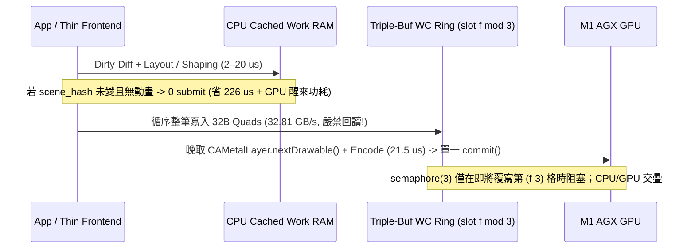
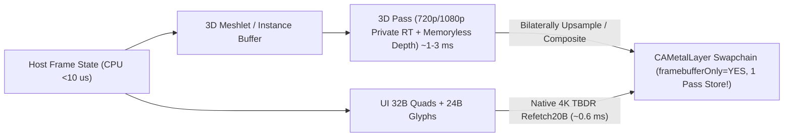

# 04｜傳輸順序優化、管線排程與同步

> 統一記憶體不是「免費傳輸」，而是把傳統 PCIe DMA 瓶頸移轉成**「Command Buffer 交接延遲、`WriteCombined` 寫入紀律、TBDR 繪製順序與 8 MB SLC 壽命管理」**。

---

## 1. CPU → GPU 傳輸順序與提交紀律

### 四條 CPU 端傳輸鐵律
1. **Triple-Buffered `Shared | WriteCombined` Ring + `dispatch_semaphore(3)`**：
   - 實測對比 60 幀小負載：同步等待 `330.9 µs/frame` → **Triple-Buffer 非同步降至 `154.7 µs/frame`**，CPU encode+commit 實耗僅 **`21.5 µs/frame`**。
   - 小於 ~`256 KB` 的每幀 UI 原語，進預先分配的 WC Ring（`16 KB memcpy = 0.50 µs`、`64 KB = 1.46 µs`）全面優於每幀重新 `posix_memalign(16384)` + `newBufferWithBytesNoCopy` 釘頁（`6.12–6.54 µs`）。
2. **循序只寫不讀（Write-Combining 紀律）**：
   - 實測 `Shared_WC` 循序寫高達 `32.81 GB/s`，但只要在 CPU 觸發任何回讀，速度立刻崩跌 **`93×` 至 `0.33 GB/s`**！
   - 寫入順序必須依原語種類分桶連續寫（Quads、Glyphs、Shadows 各自循序 append），**禁止在 WC 記憶體做原位排序、碰撞檢測或增量修改 (`+=`)**。
3. **Event-Driven + Dirty Diff（靜止 = `0` 次 GPU 提交）**：
   - 單次 1-TG 喚醒 GPU 往返就需要 **`225.8 µs`**（p95 `262.9 µs`）且消耗封裝 TDP。桌面編輯器 / 靜態策略遊戲畫面若無 Dirty Flag 且無動畫時脈，直接跳過 `commit`、`0` 喚醒 GPU。
4. **晚取 `nextDrawable` + `CAMetalDisplayLink` Frame Pacing**：
   - 永遠先跑完 CPU Layout / GPU Offscreen Compute / Prepass 編碼，直到真正要編碼最終 Swapchain `MTLRenderCommandEncoder` 前才呼叫 `[layer nextDrawable]`，避免長時間卡住 WindowServer 的 3 張 drawable 造成輸入延遲與掉幀。

---

## 2. GPU 繪製順序、TBDR HSR 與 Early-Z 實測真相

在 `3840×2160 (4K)` 疊加 `16` 層滿版高算力 (`16-iter trig`) 幾何體，實測 Apple M1 TBDR 硬體遮蔽消除行為（`[7/7] early_z`）：

| 測試案例 (`@ 4K`) | Back-to-Front (`Depth=Always, NoWrite`) | Front-to-Back (`Memoryless Depth32F, Less+Write`) | 相對 1× 基準 (`4.323 ms`) 倍率 | 物理真相與關鍵警告 |
| :--- | :---: | :---: | :---: | :--- |
| **`1x` 全螢幕基準** (`blend=NO`) | **`4.323 ms`** | — | `1.00×` | 單層真實片元計算耗時 |
| **`16x` 實心不透明** (`blend=NO`, 無 discard) | `4.362 ms` | `4.364 ms` | **`1.01×` (`15` 層被硬體消光!)** | **Apple TBDR 內建 Hidden Surface Removal (HSR)**：無 discard 且不透明時，就算不開 Depth 也能在 Tile 內剔除被後續蓋住的片元！ |
| **`16x` 常數不透明 + `blend=YES`** (`a=1.0` 常數) | `4.363 ms` | `4.362 ms` | `1.01×` | 編譯期常數 `a=1.0` 與無 discard 仍被驅動/HSR 優化為覆蓋 |
| **真半透明 16 層** (`[5/7] 16x Glass`, `a=0.18`) | **`12.574 ms`** | — | **`~2.9×` (無法 HSR)** | 真正 `a < 1.0` 混合時必須全數著色；因此 **實心背景絕對不要放進 `blend=YES` 的通用 Pass**！ |
| **`16x` 含 `discard_fragment()`** (模擬不當 Alpha-Test / SDF Clip) | **`68.133 ms`** | **`28.233 ms`** | **Back→Front 暴慢 `15.8×`！** | **`discard_fragment()` 直接摧毀 TBDR HSR！** 開啟 Front-to-Back Early-Z 可搶救回 `2.41×`，但仍比零 `discard` 慢 `6.5×`！ |

### BLOOM 鐵律級 Pass 與繪製排序順序

1. **禁止在熱路徑使用 `discard_fragment()`**：
   UI 圓角與裁剪一律由 Vertex 預裁剪 + Fragment 解析 AA `alpha = clamp(0.5h - sdf, 0, 1)` 處理；3D 不透明幾何一律零 `discard`（只有植被樹葉孤立進專用 Pass）。
2. **Pass 排程順序（對齊硬體 HSR + Early-Z + `Memoryless` 深度）**：
   - **Pass 1：3D / UI Opaque Pass（`blend = NO`, 零 `discard`, Front-to-Back 粗排序 + `Memoryless Depth32Float` Depth-Write）**：
     凡實心 UI 面板、背景底框、不透明 3D 網格全走此 Pass（師法 `gpui_apple` 獨立 `opaque_quads_pipeline_state` 的設計，但不需受限於 160B 結構）。一旦寫入深度，後方被遮擋的複雜漸層、字體、3D 片元全部免費略過！
   - **Pass 2：3D Translucent / UI Alpha-Blended Pass（`blend = SrcAlpha/OneMinusSrcAlpha`, Back-to-Front Painter Order, `DepthCompare = LessEqual`, `DepthWrite = NO`）**：
     僅畫真正半透明元件、AA 圓角邊框、Glass、`BloomGlyphInst` 字形、`BloomShadowInst` 陰影。
3. **狀態排序鍵（64-bit Sort Key）**：
   - Opaque：`[Pass:4 | ShaderPSO:8 | Material/Atlas:12 | FrontToBackDepth:20 | InstanceSeq:20]`
   - UI / Translucent：`[Pass:4 | Z_Layer/DrawOrder:24 | ShaderPSO:8 | AtlasTextureID:12 | SubOrder:16]`（只有 DrawOrder/Overlap 不變的前提下才合併相同 PSO 與 Atlas Batch，徹底壓低 Draw Call 與 Pipeline Switch）。

---

## 3. Compute → Render 同槽位 8 MB SLC 接力實測

在 `3840×2160 (4K)` 下固定渲染 `65,536` 個 `4×4 px` `BloomQuadHot`，改變 Compute 產生、Render 立即讀取的中間緩衝區大小（`2.0 MB` 命中 SLC vs `24.0 MB` 溢出 SLC）與同步切法（`[7/7] slc_handoff`）：

| 中間緩衝區大小 | `SameCB + Tracked` (GPU / Wall) | `SameCB + Untracked + MTLFence` (GPU / Wall) | `SplitCB` (`commit+wait` 中斷) (GPU / Wall) | 物理差距解讀 |
| :--- | :---: | :---: | :---: | :--- |
| **`2.0 MB`** (65536×32B，**命中 8 MB SLC**) | **`1.018 ms`** / `1.368 ms` | **`1.019 ms`** / **`1.360 ms`** | `0.991 ms` / **`1.640 ms`** (`+0.28 ms` CPU 斷裂) | Compute 寫完直接熱騰騰留在 8 MB SLC 內由 Vertex/Fragment 消費；**拆成兩個 CB 白白損失 `~280 µs` 喚醒與同步牆！** |
| **`24.0 MB`** (12× 步幅，**3× 溢出 8 MB SLC**) | `2.156 ms` / `2.510 ms` | `2.162 ms` / `2.561 ms` | `2.118 ms` / **`2.948 ms`** | 緩衝區大於 8 MB 迫使中間結果被驅逐到 55 GB/s LPDDR4X DRAM，GPU 耗時直接翻倍 (`+1.14 ms`)；拆開兩條 CB 更增加 **`+0.44 ms` 同步懲罰**。 |

**設計原則**：
* **同條 Command Buffer 一竿到底**：任何一幀內的 `Atlas Upload (Blit) → GPU Culling / Prefix-Sum (Compute) → Opaque / UI RenderPass → Final Present` 全編碼進**同一條 `MTLCommandBuffer`**（多 Pass 間以 `MTLHeap` + `Untracked` + `MTLFence` 或預設追蹤接力），絕不中斷 `waitUntilCompleted` 跨端乒乓。
* **中間工作集壓在 `≤ 4–6 MB`**：確保 Compute → Render 的 Culling / Compacted Instance List 完全不溢出 8 MB SLC。

---

## 4. 3D 與 4K UI 解析度解耦管線

為了讓 3D 場景與 4K UI 在同一台 M1 上同時穩跑 60–120 FPS（徹底甩開 `v9` 全螢幕 4K 3D 光線追蹤 `257.1 ms` 的死路）：

* **3D 降尺度渲染（`1280×720` 或 `1920×1080` `MTLStorageModePrivate` RT）**：面積分別只有 4K 的 `1/9` 與 `1/4`，將光柵/陰影/著色壓在 `1–3 ms`。
* **單次合成上 Swapchain**：在最後一個針對 `CAMetalLayer`（`framebufferOnly = YES`）的 RenderPass 中，第一個 Draw 用採樣全螢幕雙邊取樣貼上 3D 背景，緊接著在同一條 RenderPass 的片上 Tile Memory 裡直接疊畫 **原生 4K 銳利 UI**（`0.58 ms`），最後一次性寫出無損壓縮後的 `BGRA8` Swapchain。**全程零全螢幕 Compute HDR 中繼緩衝、零額外全螢幕 Blit Pass。**
