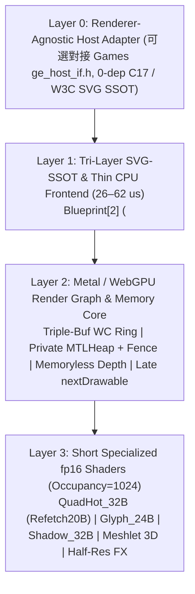

# 05｜BLOOM vNext 純 GPU 架構藍圖與待討論決策

> 站在完整的 Apple M1 矽片實測證據之上，本章收斂整個研究系列，給出 BLOOM vNext 的 **基準對照總表**、**7 條不可妥協的硬體鐵律**、**模組分層藍圖**，以及 **5 項準備進入實作前必須定案的架構決策**。

---

## 1. 全代架構與實測總對照表

| 引擎 / 原型 | 4K 純 UI (2k Quads / 16 視窗+字型) | 4K 20k Quads | 4K 綜合 IDE+HUD (`15k` 字+UI+陰影) | 4K 3D / 合成 | 核心架構決定性差異 |
| :--- | :---: | :---: | :---: | :---: | :--- |
| **BLOOM `v1.0.0`** (Metal 舊基線) | `~6.19 ms` (full+SVG) / `0.72–0.80 ms` (empty) | — | — | `6.9–11.5 ms` (125k tris) | 864-line MSL 硬體光柵化 |
| **BLOOM `v2.0.0`** (`bento_glass`) | `10.45 ms` (`95.7 fps`, 16 full win) | — | — | — | 603-line MSL, `maxTG=1024` |
| **Archived `v9`** (`5,123` 行 megashader) | **`14.08 ms`** (empty) → **`26.41–35.12 ms`** (16 full+text) | N/A (`16-node` 天花板) | N/A (`16-node` 天花板) | **`257.10 ms`** (`3.9 fps`) | 11,711 行 MSL、`448–640` Occupancy 崩盤、全螢幕 HDR Compute UI + CPU UTF-8 迴圈 + 額外 Blit |
| **`zed-main` GPUI 實測** (`160 B` Quad + `112 B` Sprite/Shadow) | `0.87 ms` (`2k` solid) / `0.93 ms` (`16q`) 探針 `176B` 圓角邊框：**`1.087 ms`** | 探針 `176B`：**`10.424 ms`** 混合 Dual-Pass：**`5.928 ms`** | **`1.274 ms`** (`1,677 KB` buf, `785 fps`) | 無原生 3D | TBDR `RenderCommandEncoder` + `Memoryless Depth` + `Shared\|WC` Ring，但 `112–160 B` Monolithic + `56–100 B` StageIn + `Shared` Atlas |
| **BLOOM vNext 探針 (`Refetch20B + 24/32 B Hot`)** | **`0.581 ms` (`1,721 fps`, 2k 圓角帶框)** / `0.557–0.612 ms` (`256 widgets`) | **`4.802 ms` (`208 fps`)** 混合 Pre-Part：**`4.186 ms`** | **`0.671 ms`** (`359.5 KB` buf, **`1,491 fps`**) | 降尺度 3D 預期 `~1–3 ms` + 4K UI `~0.6 ms` | **`32 B` Quad/Shadow + `24 B` Glyph + `20 B StageIn` (`Refetch20B`) + GPU L1 重讀 + Pre-Partitioned Opaque + `Private+Opt` Atlas (`1.90×` 快於 GPUI)** |

*(完整 `zed-main` GPUI 全元件拆解與 Adopt/Beat/Skip 矩陣見 [`06_gpui_component_benchmark.md`](./06_gpui_component_benchmark.md#L105-L120))*

---

## 2. BLOOM vNext 七條不可妥協的硬體鐵律（CI Gates）

未來寫下任何一行正式程式碼，都必須由自動化基準測試守住以下七道閘門：

1. **Zero `FLOW` / Zero 64-bit Compute**：Shader 禁止任何 `u64`/`i64` 模擬算術（M1 GPU 慢 `19.2×`：`107.1 G_u64_OPS` vs `2,061.9 GFLOPS fp16`）與科學計算法則；`BLOOM` 零 `#include` `FLOW` 與遊戲核心標頭檔。
2. **Shader Occupancy Gate (`maxTotalThreadsPerThreadgroup == 1024`)**：所有常規渲染與 UI Shader 保持極短特化（單檔 ≤ 400 行），嚴禁再出現降 Occupancy 至 `384–448` 的 Megashader；`alu_precision` 證實降暫存器壓力即可把 `fp32` 吞吐從 `960.9` 拉高到 `1,719.3 GFLOPS`。
3. **離散圖元 100% 走 TBDR RenderPass (`framebufferOnly = YES`)**：UI / 2D / 3D 網格全面走硬體光柵（`127.54×` 快過全螢幕掃描 Compute）；`CAMetalLayer` 不開 `ShaderWrite`，保留片上無損壓縮。
4. **`20 B` StageIn + `32 B` Hot L1 Refetch (`Refetch20B`)**：UI 管線禁止把 `44–72 B` 頂點屬性塞進 Tiler Parameter RAM；只傳 `pos + quad_id [[flat]]`，Fragment 走 L1 讀 `32 B` `BloomQuadHot`（4K 2k Quads 鎖在 `< 0.7 ms`）。
5. **Zero-Discard Opaque + `Memoryless Depth32Float`**：UI 實心底與 3D 不透明幾何一律零 `discard_fragment()`（避免 HSR 崩壞 `15.8×` 到 `68.1 ms`），切進獨立 Opaque Pass（`blend = NO`）。
6. **記憶體分層與只寫紀律**：每幀 Ring 用 `Shared | WriteCombined`（`32.81 GB/s` 循序只寫，**CI/Audit 嚴禁 CPU 讀取 WC**：`0.33 GB/s` 斷崖）；字體 Atlas 與 3D 資產全放 `Private + allowGPUOptimizedContents = YES`（快 `1.8×`）；深度緩衝全用 `Memoryless`。
7. **Single-CommandBuffer + `≤ 4–6 MB` SLC 預算 + Idle Zero-Submit**：一幀只 `commit` 1 次（Triple-Buffer `sem=3` 交疊）；Compute → Render 中間緩衝壓在 8 MB SLC 內；靜止無髒區與動畫時 `0` 次提交。

---

## 3. BLOOM vNext 四層純 GPU 模組藍圖

---

## 4. 五項開放架構決策（供下一步討論定案）

研究探針已經把所有矽片邊界摸透，現在剩這 **5 個產品與工程方向** 需要我們拍板，拍板後就可以在明確的邊界內重寫乾淨的 BLOOM vNext：

1. **後端優先順序：Metal-First 原生管線 vs WebGPU (wgpu / Dawn) 同源跨平台？**
   - **選項 A（建議優先驗證，並參考 `gpui_apple` + `gpui_wgpu` 雙後端切線）**：核心 ABI 與 Shader 資料結構設計先 **對齊 Apple M1 原生 Metal 最佳佈局**（`32 B` `Refetch20B`、`Memoryless`、`Shared|WC`、`Private+Opt` Atlas、`MTLHeap`），同時只用 32-bit 原生型別讓 WebGPU `gpui_wgpu`-style storage buffer 後端能等價實作（絕不為了抽象層妥協 `Private` / `Refetch20B` / `Memoryless` 或讓 WebGL 退路拖累主線）。
   - **選項 B**：全程先綁 `wgpu-native` / `SDL3-GPU` 單一抽象層（工程上較單純，但無法精細控制 `WriteCombined` / `Private+Opt` / `Memoryless` / 同 CB `Blit→Render`，且容易重蹈舊版轉譯降 Occupancy 的風險）。

2. **CPU UI 前端定位：Tri-Layer W3C SVG-SSOT 融合架構 vs 只做極低階 Immediate-Mode Painter？**
   - [`07_svg_ssot_fusion.md`](./07_svg_ssot_fusion.md) 已完成實證：透過把「不可變 `Blueprint[2]`（含 `<defs>/<symbol>/<use>`、`<style>` 偽類、巢狀 Flex）」與「依 `fnv1a64(id)` 對齊的 `StateStore`」及「`WC Ring → Refetch20B TBDR`」拆離，可保留瀏覽器可視化預覽與無狀態流失熱重載（`reconcile+relayout = 62.29 µs`），同時讓 4K `500`-節點介面鎖在 **`1.087 ms` (`920 fps`)**。
   - **待決**：BLOOM Layer 1 是否直接內建此零堆積 Tri-Layer W3C SVG-SSOT 前端（兼保留純原語 Painter C API），取代舊版 `16-node` 受限編譯器與無 XML Auto-Bento？

3. **3D 主場景管線：純硬體 Triangle/Meshlet 光柵化 vs「硬體光柵主 pass + 選擇性半解析度 SDF/GI 特效」？**
   - M1 上硬體光柵輕鬆穩住 4K/1080p 120 FPS；全螢幕 4K SDF raymarch 要 `257 ms`。
   - **待決**：Games 3D 舞台（如 `Games/tools/model_forge.py` 已生成的 GLB 網格）是否直接走 **標準硬體 Mesh Raster + PBR/Toon 着色**，完全淘汰全螢幕 Raymarching，只保留低成本特效？

4. **文字渲染管線：macOS CoreText/FreeType 點陣 Alpha Atlas (`R8Unorm`) vs MSDF 多通道向量 Atlas？**
   - **Alpha Atlas (`R8Unorm`)**：1x Retina/4K 字體銳利度與蘋果原生一致性最好（GPUI 路線），僅在縮放動畫時多佔幾格字號快取。
   - **MSDF (`RGBA8`)**：適合遊戲世界內任意縮放文字與向量符號/公式，但小字號在 Subpixel/Hinting 上不如 CoreText 銳利。

5. **視窗與輸入宿主層：極薄原生 Cocoa/NSWindow (`CAMetalLayer`) + WASM 宿主 vs SDL3 僅負責開窗與事件？**
   - **原生 Cocoa / ObjC shim**（~400 行零外部庫）：直接掌控 `CAMetalDisplayLink`、晚取 `nextDrawable`、`framebufferOnly=YES`、高精準觸控與 IME，靜態二進位極小（類似 `m1_silicon_probe` 零三方依賴）。
   - **SDL3 僅管 Window/Input**：跨平台快，但要明確禁用 `SDL_GPU` 的自動 Offscreen Blit 與 Shader 轉譯層，直接從 `SDL_GetProperty` 拿原生 `CAMetalLayer`。
