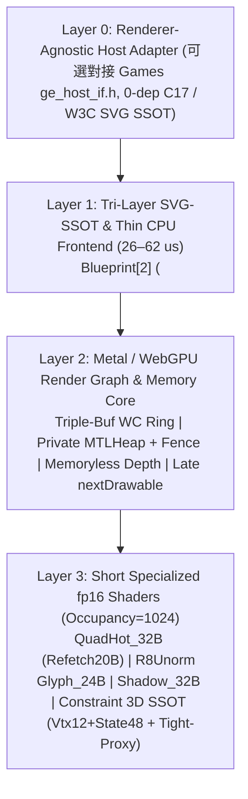

# 05｜BLOOM vNext 純 GPU 架構藍圖與待討論決策

> 站在完整的 Apple M1 矽片實測證據之上，本章收斂整個研究系列，給出 BLOOM vNext 的 **基準對照總表**、**7 條不可妥協的硬體鐵律**、**模組分層藍圖**，以及 **5 項準備進入實作前必須定案的架構決策**。

---

## 1. 全代架構與實測總對照表

| 引擎 / 原型 | 4K 純 UI (2k Quads / 16 視窗+字型) | 4K 20k Quads | 4K 綜合 IDE+HUD (`15k` 字+UI+陰影) | 4K 3D / 合成 | 核心架構決定性差異 |
| :--- | :---: | :---: | :---: | :---: | :--- |
| **BLOOM `v1.0.0`** (Metal 舊基線) | `~6.19 ms` (full+SVG) / `0.72–0.80 ms` (empty) | — | — | `6.9–11.5 ms` (125k tris) | 864-line MSL 硬體光柵化 |
| **BLOOM `v2.0.0`** (`bento_glass`) | `10.45 ms` (`95.7 fps`, 16 full win) | — | — | — | 603-line MSL, `maxTG=1024` |
| **Archived `v9`** (`5,123` 行 megashader) | **`14.08 ms`** (empty) → **`26.41–35.12 ms`** (16 full+text) | N/A (`16-node` 天花板) | N/A (`16-node` 天花板) | **`257.10 ms`** (`3.9 fps`) | 11,711 行 MSL、`448–640` Occupancy 崩盤、全螢幕 HDR Compute UI + CPU UTF-8 迴圈 + 額外 Blit |
| **`zed-main` GPUI 實測** (`160 B` Quad + `112 B` Sprite/Shadow) | `0.87 ms` (`2k` solid) / `0.93 ms` (`16q`) 探針 `176B` 圓角邊框：**`1.087 ms`** | 探針 `176B`：**`10.424 ms`** 混合 Dual-Pass：**`5.928 ms`** | **`1.274 ms`** (`1,677 KB` buf, `785 fps`) | 無原生 3D | TBDR `RenderCommandEncoder` + `Memoryless Depth` + `Shared\|WC` Ring，但 `112–160 B` Monolithic + `56–100 B` StageIn + `Shared` Atlas |
| **BLOOM vNext 探針 (`Refetch20B + 3D SSOT`)** | **`0.581 ms` (`1,721 fps`, 2k 圓角帶框)** / `0.557–0.612 ms` (`256 widgets`) | **`4.802 ms` (`208 fps`)** 混合 Pre-Part：**`4.186 ms`** | **`0.671 ms`** (`359.5 KB` buf, **`1,491 fps`**) | **`0.959 ms` (`1,042.5 fps`)** *(4K Single-CB `1,024` 3D/`98k` tris + `64` Tight-Proxy + 滿載 SVG HUD)* | **`32 B` Quad/Shadow + `24 B` Glyph + `20 B` StageIn (`Refetch20B`) + `12 B` Vtx / `48 B` State + Tight-Proxy `O(1)` (`1.90×` 快於 GPUI、`268×` 快於 v9 3D)** |

*(完整 `zed-main` GPUI 全元件拆解見 [`06_gpui_component_benchmark.md`](./06_gpui_component_benchmark.md#L105-L120)；3D 物件本體實測見 [`08_object_ssot_3d.md`](./08_object_ssot_3d.md))*

---

## 2. BLOOM vNext 七條不可妥協的硬體鐵律（CI Gates）

未來寫下任何一行正式程式碼，都必須由自動化基準測試守住以下七道閘門：

1. **Zero `FLOW` / Zero 64-bit Compute**：Shader 禁止任何 `u64`/`i64` 模擬算術（M1 GPU 慢 `19.2×`：`107.1 G_u64_OPS` vs `2,061.9 GFLOPS fp16`）與科學計算法則；`BLOOM` 零 `#include` `FLOW` 與遊戲核心標頭檔。
2. **Shader Occupancy Gate (`maxTotalThreadsPerThreadgroup == 1024`)**：所有常規渲染與 UI Shader 保持極短特化（單檔 ≤ 400 行），嚴禁再出現降 Occupancy 至 `384–448` 的 Megashader；`alu_precision` 證實降暫存器壓力即可把 `fp32` 吞吐從 `960.9` 拉高到 `1,719.3 GFLOPS`。
3. **離散圖元 100% 走 TBDR RenderPass (`framebufferOnly = YES`)**：UI / 2D / 3D 網格全面走硬體光柵（`127.54×` 快過全螢幕掃描 Compute）；`CAMetalLayer` 不開 `ShaderWrite`，保留片上無損壓縮。
4. **`20 B` StageIn + `32 B` Hot L1 Refetch (`Refetch20B`)**：UI 管線禁止把 `44–72 B` 頂點屬性塞進 Tiler Parameter RAM；只傳 `pos + quad_id [[flat]]`，Fragment 走 L1 讀 `32 B` `BloomQuadHot`（4K 2k Quads 鎖在 `< 0.7 ms`）。
5. **Zero-Discard Opaque + `Memoryless Depth32Float`**：UI 實心底與 3D 不透明幾何一律零 `discard_fragment()`（避免 HSR 崩壞 `15.8×` 到 `68.1 ms`），切進獨立 Opaque Pass（`blend = NO`）。
6. **記憶體分層與只寫紀律**：每幀 Ring 用 `Shared | WriteCombined`（`32.81 GB/s` 循序只寫，**CI/Audit 嚴禁 CPU 讀取 WC**：`0.33 GB/s` 斷崖）；字體 Atlas 與 3D 資產全放 `Private + allowGPUOptimizedContents = YES`（快 `1.8×`）；深度緩衝全用 `Memoryless`。
7. **Single-CommandBuffer + `≤ 4–6 MB` SLC 預算 + Idle Zero-Submit**：一幀只 `commit` 1 次（Triple-Buffer `sem=3` 交疊）；Compute → Render 中間緩衝壓在 8 MB SLC 內；靜止無髒區與動畫時 `0` 次提交。

---

## 3. BLOOM vNext 四層純 GPU 模組藍圖

---

## 4. 架構決策狀態（4 項已定案，決策 #3 進入語法收斂討論）

研究探針已經把所有矽片邊界與物件資料模型摸透，5 項架構方向的最新狀態如下：

1. **後端優先順序：Metal-First 原生管線 + WebGPU 同源佈局 — ✅ 已定案（選項 A）**
   - 核心 ABI 與 Shader 資料結構對齊 Apple M1 原生 Metal 最佳佈局（`32 B` `Refetch20B`、`Memoryless`、`Shared|WC`、`Private+Opt` Atlas、`MTLHeap`），同時全數使用 32-bit 原生友善型別（搭配 C++/MSL 雙側 `static_assert` 與純量欄位守則），讓 `gpui_wgpu`-style WebGPU storage buffer 後端可等價實作而不向最低公分母妥協。

2. **CPU UI 前端定位：Tri-Layer W3C SVG-SSOT 融合架構 — ✅ 已定案（ok，內建 SVG-SSOT + 純原語 Painter C API）**
   - [`07_svg_ssot_fusion.md`](./07_svg_ssot_fusion.md) 已完成實證：`Blueprint[2]`（含 `<defs>/<symbol>/<use>`、`<style>` 偽類、巢狀 Flex）+ `fnv1a64(id)` `StateStore`（`reconcile+relayout = 62.29 µs`）+ `WC Ring → Refetch20B TBDR`，兼保留極低階純原語 Painter C API，全面取代舊版 `16-node` 受限編譯器。

3. **3D 主場景與物件本體：Constraint-Native Dual-Track 3D Object SSOT — 🔶 硬體層已實證，待定案語法層**
   - [`08_object_ssot_3d.md`](./08_object_ssot_3d.md) 實證了比業界 `.glb` (`64B + 512B`) 更低維的新規格：**準確幾何只於 `init` 定格，Runtime 只傳 `48 B` 約束狀態變換**（M1 上比蒙皮管線 **快 `3.65×` GPU / 少 `10.7×` WC 頻寬**）；`ComputeCull+Indirect` (`0.419 ms`) 勝過 Metal 3 Object+Mesh (`0.812 ms`)；Track B `Tight-Proxy O(1)` (`0.376 ms`) 與硬體 `[[clip_distance]]` (`0.687 ms` vs `discard` `1.172 ms`) 合計在單一 CB 完成 **4K 3D+HUD 複合幀僅 `0.959 ms` (`1,042.5 fps`)**，對照舊版 v9 `257.10 ms` 提升 **`268×`**。
   - **待與使用者繼續討論定案**：3D Object SSOT 規格文件要採 **方案 3A（`<bloom-obj>` 宣告式 XML，與 SVG 共用 `fnv1a64(id)` 熱更新管線）**、**方案 3B（SVG 內嵌 `<bloom-scene>`）**，還是 **方案 3C（`.bobj` 二進位 Header + Manifest）**？

4. **文字渲染管線：CoreText / FreeType 點陣 Alpha Atlas (`R8Unorm`) — ✅ 已定案（Alpha）**
   - 主線採用 `R8Unorm` `Private+Opt` 點陣 Alpha Atlas，確保 Retina/4K 小字體銳利度與蘋果原生渲染一致性，字號縮放動畫則依需求快取適量級距；24 B `BloomGlyphInst` 在 4K `12k–15k` 字元下僅約 `0.21–0.67 ms` 整體幀預算。

5. **視窗與輸入宿主層：極薄原生 Cocoa/NSWindow (`CAMetalLayer`) + WASM 宿主 — ✅ 已定案（對）**
   - 採用零三方依賴原生 Cocoa / ObjC shim（直接掌控 `CAMetalDisplayLink`、晚取 `nextDrawable`、`framebufferOnly=YES`、高精準觸控與 IME），Web 目標對應極薄 WASM WebGPU 宿主；完全不引入肥大外部抽象層與自動 Offscreen Blit。
