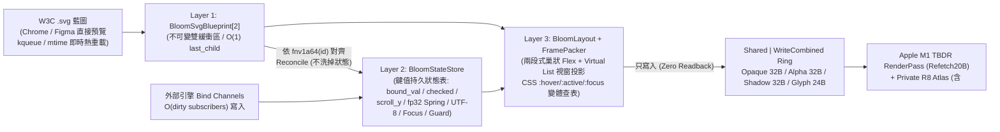

# 07｜SVG-SSOT 融合架構：Git 歷史法醫審計 × 純 GPU TBDR 實證

> 回應架構核心問題：**既然前端正收斂為宣告式 XML + 熱重載，我們能否讓「標準 W3C SVG」成為瀏覽器可直接預覽、Bootstrap 模板化複用、原生即時熱重載的唯一視覺真相源 (SSOT)，同時完全保留 BLOOM vNext 在 Apple M1 上 `< 1.1 ms @ 4K` 的純 GPU 效能與完整互動語意？**
> 本章先透過 `git` 歷史審計 BLOOM 三代 SVG-UI 的成敗，再給出 **Tri-Layer SVG-SSOT 融合架構** 與 [`svg_ssot_bench.mm`](./probes/svg_ssot_bench.mm) 在本機 Apple M1 上的 6 組全量實測（原始數據：[`build/svg_ssot_results.json`](./build/svg_ssot_results.json)）。

---

## 1. BLOOM Git History 法醫考古（`v1.0.0` → `v2.0.0` → `v6–v9`）

翻開 `BLOOM` 完整 `git` 歷史，互動式 SVG-UI 並非新念頭，它已經歷過三次完整演化，留下清晰的可複用資產與致命反模式：

| 世代 / Commit | 關鍵檔案與行數 | 核心實作與驗證證據 | 真相審計（成功 vs 退場/失敗） |
| :--- | :--- | :--- | :--- |
| **Gen 1 (`v1.0.0`)**<br>pre-`bac1e44` (`1341b74`) | `include/flow_svg_ui.h` (`569` 行)<br>`src/svg_ui_core.c` (`1,657` 行)<br>`include/gpu/flow_svg_ui_pass.h` (`139` 行)<br>`tests/test_svg_ui_framework.c` (`538` 行)<br>`research/SvgUiFramework.lean` (`379` 行) | **13/13 測試全數通過**：標準 `<svg viewBox>` 編譯 (`64` 節點上限)、16:9↔21:9 零重排錨點、`Wave64` 8×8 空間遮罩、`Pointer Capture` 跨 Tile 拖曳、Register Bank O(1) 綁定、Flexbox + 捲動夾限、UTF-8 TextInput + CJK IME、**`FlowUiIntentSpec64` Auto-Bento** 與 22 條 Lean 定理 | **CPU 互動機制完整驗證成功**；缺點是深度綁定 `FLOW` ABI 與 `Shader` SDF 迴圈（GPU 跑全螢幕 HDR Compute，4K 帶 UI 僅 `~6.19 ms`） |
| **Gen 2 (`v2.0.0`)**<br>`8996868` & `bac1e44` | 刪除 `svg_ui_core.c` (`-1,657` 行) 與 `flow_svg_ui.h` (`-569` 行)；改寫 [`Bloom.lean`](../archive/v9/Bloom.lean) (`1,258` 行 @ v2) | 主張用「零 XML 的純 Lean 4 `FlowUiIntentSpec64` Auto-Bento」完全取代手寫 SVG 與 hex 色彩（`-9000 LOC` 大瘦身） | **宣告式工程教訓**：純演算法 Auto-Bento 適合遙測儀表格，但**無法取代設計師視覺編輯、瀏覽器直接預覽與固定面板排版**；因此 `v6.0.0` (`2b322ed`) 又把 `.svg` 寫回來 |
| **Gen 3 (`v6–v9`)**<br>`2b322ed` → `a2f1e69` → `a7d4296` | [`studio_inspector.svg`](../archive/v9/specs/studio_inspector.svg) (`68` 行, `3,915 B`)<br>[`bloom_ui.h`](../archive/v9/include/bloom_ui.h) (`367` 行)<br>[`bloom_ui.c`](../archive/v9/src/bloom_ui.c) (`1,976` 行)<br>[`bloom_cli.c`](../archive/v9/src/bloom_cli.c) (`--watch-svg`)<br>[`bloom_core.wgsl`](../archive/v9/shaders/bloom_core.wgsl) (`L3529-3740`) | 復刻全部 C17 CPU UI 引擎並加上 **Agent-Native SDK** (`Snapshot`/`Query`/Roving TabIndex/Disabled/Toggle/Modal Trap/FIR1 Guard，`12/12` Mutation Kill)、`mtime` 熱重載（[`bloom_cli.c:997-1013`](../archive/v9/src/bloom_cli.c#L997-L1013)） | **CPU 狀態機極快 (`2.18 µs/f`) 且穩定**，但 SVG 當成 SSOT 與 GPU 渲染發生 **6 個致命斷裂**（見下表） |

### `v1` 與 `v6–v9` 已證實成功 vs 實測斷裂的 6 個致命缺口

- **已證實完全成功的（必須保留進 BLOOM vNext）**：
  1. **零堆積 (Zero-Malloc) C17 互動核心**：[`bloom_ui.c:750-880`](../archive/v9/src/bloom_ui.c#L750-L880) 與 [`1651-1859`](../archive/v9/src/bloom_ui.c#L1651-L1859) 的 **Pointer Capture**（滑鼠拖出滑桿包圍盒仍持續精細調整）、**Roving TabIndex 焦點輪轉**、**Disabled / Modal Trap 阻斷**、**UTF-8 邊界檢查與 CJK IME Preedit**、**JSON Snapshot 匯出**，全部被 `12/12` 變異測試驗證且實測僅微秒級成本。
  2. **`viewBox` 基準標準 `.svg`**：[`studio_inspector.svg`](../archive/v9/specs/studio_inspector.svg) 可直接拖進 Chrome / Figma 開啟，證明「一個 `.svg` 同時給瀏覽器與原生引擎讀」路線完全可行。

- **必須根治的 6 個實作缺口與物理撞牆**：
  1. **熱重載直接 `memset` 清光全部互動狀態**：[`bloom_ui.c:279,371`](../archive/v9/src/bloom_ui.c#L279-L371) 與 [`bloom_cli.c:1000-1006`](../archive/v9/src/bloom_cli.c#L1000-L1006) 在重新編譯 `.svg` 時把整個 `ui_nodes[]` 與 `dom`（含 `hovered`、`active`、`captured`、`focused`、`checked` 與滑桿目前數值）原地歸零重刷；只要改色存檔，使用者正在拖動的數值、切換開關與焦點就瞬間流失。
  2. **`data-label` 根本沒解析、標籤竟硬編在 WGSL**：[`studio_inspector.svg:9,15,21,27,33,39`](../archive/v9/specs/studio_inspector.svg#L9-L39) 寫了 `data-label="BLOOM STUDIO"` 等屬性，但 `bloom_ui.c` **一行都沒解析 `data-label` 也沒支援 `<text>`**；真正畫面文字竟然靠 [`bloom_core.wgsl:2725-2745`](../archive/v9/shaders/bloom_core.wgsl#L2725-L2745) 的 `resolve_ui_label` 把 `"BLOOM STUDIO"` / `"X-RAY"` 等寫死在十六進位常數裡！同時缺少 `<text>` 導致瀏覽器預覽時按鈕全空字。
  3. **`3,328 B` 堆疊截斷與 `16` 節點天花板**：[`bloom_ui.c:391`](../archive/v9/src/bloom_ui.c#L391) 開了固定 `char svg_buf[3328]`（連壓縮前的 `3,915 B` `studio_inspector.svg` 都逼近極限，超過 `4 KB` 即靜默截斷）；`BLOOM_MAX_UI_NODES = 16`、每個 `<path>` 最多 `5` 條直線段，完全裝不進真實軟體介面。
  4. **無巢狀 `<g data-layout>` / `<symbol>/<use>` / `<clipPath>`**：[`bloom_ui.c`](../archive/v9/src/bloom_ui.c#L237-L366) 忽略所有 `<g>` 階層、`transform`、`class` CSS 與複用元件，導致真實應用無法做 Flexbox 自動對齊、Bootstrap 樣式複用或捲動裁剪。
  5. **UI 跑全螢幕 HDR Compute Pass 導致擴展崩潰**：[`bloom_core.wgsl:3529-3740`](../archive/v9/shaders/bloom_core.wgsl#L3529-L3740) 對螢幕上每個像素跑 `for (i = 0..ui_cnt)` SDF 評價。下方第 4 節實測證明：即使把 UI Compute 單獨抽出並拉滿 `maxTG=1024`，`256` 個元件在 4K 上依然暴跌至 **`47.111 ms` (`21.2 FPS`)**！
  6. **SVG 解析與 `FLOW v9` 硬綁定**：[`bloom_ui.c:4,871`](../archive/v9/src/bloom_ui.c#L871) 把物理彈簧與防護網塞進 `flow_step_atlas` 與 `flow_ir_eval_u64`，違背 BLOOM 純 GPU 獨立原則。

---

## 2. Tri-Layer SVG-SSOT 融合架構（零耦合純 GPU 解法）

解決方法不是退回手寫 C 座標，也不是搬瀏覽器整套 DOM/V8，而是把 **「視覺設計檔 (`.svg`)」**、**「活躍互動狀態 (`StateStore`)」** 與 **「GPU 渲染幀 (`TBDR`)」** 切開為三層完全解耦的資料平面：



三個關鍵設計決策徹底消滅歷史痛點：
1. **身分鍵 (`NodeKey = fnv1a64(id)`) 與陣列下標 (`slot_index`) 徹底分離**：熱重載後 `<rect>` 前後順序重排、新增按鈕或改變座標與顏色時，Layer 2 只透過 `NodeKey` 雜湊槽查找現存狀態；存活節點的滑桿值、捲動偏移、`text_buf`、彈簧速度與焦點 **100% 保留**，被刪除的舊節點若剛好持有 `focused_key` 或 `captured_key` 則精準歸零，絕不殘留懸空指標。
2. **`BindTable` 逆向訂閱表 (`ch_subs[64][64]`)**：在解析 `.svg` 的 `data-bind="N"` 時建好通道→節點列表；更新遙測數值時僅觸碰該通道訂閱的節點（實測 16 通道僅 **`0.17 µs`**），不掃描整棵 UI 樹（Zero-VDOM）。
3. **Zero `FLOW` 的純 C17 閉合回呼**：把 `v9` 的 `flow_step_atlas`（64-bit jet 查表）換成 4 行原生效能最高的 `fp32` 阻尼彈簧（`spring_pos`, `spring_vel`）；Agent Guard 改為純 C17 函式指標 `bool (*AgentGuardFn)(node_key, op, val, ctx)`，上層想接 Lean、FLOW FIR1 或 Games 邏輯全由使用者在 C ABI 外決定，BLOOM 本身零外部依賴。

---

## 3. W3C 相容 SVG-SSOT 設計規範（相容 × 視覺化 × Bootstrap 模板複用 × 熱重載）

為了達到「**不用開執行檔，直接拖進 Chrome / Figma 就看到正確排版、文字、按鈕造型與陰影；存檔立刻無縫熱重載**」，SVG 編寫只需遵守以下純標準 + 漸進式 `data-*` 規範：

```xml
<svg xmlns="http://www.w3.org/2000/svg" viewBox="0 0 1920 1080" width="1920" height="1080">
  <!-- 1. Bootstrap 式可複用元件母版 + 濾鏡陰影 + 裁剪區 (全 W3C 標準) -->
  <defs>
    <filter id="card_shadow">
      <feDropShadow dx="0" dy="4" stdDeviation="12" flood-color="#000000" flood-opacity="0.35"/>
    </filter>
    <symbol id="btn_primary" viewBox="0 0 160 36">
      <rect x="0" y="0" width="160" height="36" rx="8" class="btn"/>
      <text x="16" y="23" fill="#E8F4FF" font-size="14">Apply</text>
    </symbol>
    <symbol id="row_tpl" viewBox="0 0 400 28">
      <rect x="0" y="0" width="400" height="26" fill="#1B2332"/>
      <text x="12" y="18" fill="#B8D4EE" font-size="13">RowItem</text>
    </symbol>
  </defs>

  <!-- 2. CSS 類別與互動偽類樣式 (無 JS 即可呈現 hover/active/focus/checked) -->
  <style>
    .btn { fill: #1E3248; fill-opacity: 0.88; stroke: #38BDF8; stroke-width: 1.5; rx: 8; }
    .btn:hover { fill: #254868; stroke: #7DD3FC; stroke-width: 2; }
    .btn:active { fill: #0E7490; }
    .btn:focus { stroke: #22D3EE; stroke-width: 2.5; }
    .toggle[data-checked="true"] { fill: #0EA5E9; }
  </style>

  <!-- 3. 漸進式 Flexbox + 虛擬捲動清單 + 內嵌 3D 遊戲畫面佔位區 -->
  <g id="workspace" data-layout="row" data-gap="12" data-pad="12" x="16" y="84" width="1888" height="980">
    <!-- Chrome 看見預置靜態區域，BLOOM 執行時僅產出可視區 32~33 列對應頂點 -->
    <g id="log_list" data-scroll="y" data-item-template="#row_tpl" data-item-height="28" data-total-count="10000"
       x="28" y="96" width="420" height="896"/>
    <!-- Games 3D / Metal Texture 貼圖直接合成至此 SVG 插槽座標 -->
    <g id="scene_3d" data-role="canvas" x="460" y="96" width="960" height="896"/>
    <!-- 複用按鈕實例，依 stable id 保留各自狀態 -->
    <use id="btn_commit" href="#btn_primary" x="1440" y="96" width="160" height="36" data-action="2"/>
  </g>
</svg>
```

### 熱重載對帳矩陣 (`reconcile_hot_reload`)

| `.svg` 編輯情境 | `NodeKey = fnv1a64(id)` 比對結果 | Layer 2 (`BloomStateStore`) 行為保證 |
| :--- | :--- | :--- |
| **節點順序重排、父群組搬家、改顏色/圓角/座標** | 存活 (`Surviving`) | 保留滑桿數值 `bound_value`、`checked`、`scroll_y`、`text_buf`、`spring_pos/vel`、`focused_key`、`captured_key` |
| **新增按鈕 / 面板** | 新增 (`Added`) | 從 `.svg` 的 `data-init-val` / `[data-checked]` 建立新槽位，預設 `spring_pos = 1.0` |
| **刪除舊按鈕（非焦點）** | 移除 (`Deleted`) | 標記墓碑回收槽位；不影響其他元件與互動鎖 |
| **刪除正在被 Focus 或 Drag Capture 的元件** | 移除 (`Deleted`) | **強制清空 `focused_key` / `captured_key` / `active_key`**，杜絕懸空狀態或無限拖曳鎖死 |
| **相容舊版 [`studio_inspector.svg`](../archive/v9/specs/studio_inspector.svg)** | 回退 `data-node-id` 雜湊 | 解析 `data-label` + `<path>` + `<line>`，舊版資產零修改即可升級至 TBDR |

---

## 4. Apple M1 六大實證數據（[`build/svg_ssot_results.json`](./build/svg_ssot_results.json)）

以下全部數據皆由 [`svg_ssot_bench.mm`](./probes/svg_ssot_bench.mm) 在本機 Apple M1（`-O3 -Wall -Wextra` 零警告編譯、150 ms Metal DVFS 預熱後實測、`GPUEndTime - GPUStartTime` 與 `CLOCK_UPTIME_RAW` 中位數）跑出，並通過像素雜湊與全部互動斷言驗證：

### 4.1 串流 `.svg` 編譯與熱重載速度（解除 `v9` 的 `3.3 KB` 與 `16-node` 雙天花板）

| 實測藍圖 (`svg_parse_and_hot_reload`) | 檔案大小 | 展開後節點數 | Flattened 曲線段 | CSS 規則 / Symbol / 標籤 | 編譯中位數 (`p95`) | 吞吐量 | Arena 實佔記憶體 |
| :--- | :---: | :---: | :---: | :---: | :---: | :---: | :---: |
| **`studio_inspector_v9`** (`archive/v9` 實檔) | `3,915 B` | `13` | `6` | `0 / 0 / 6` (**PASS 含 `"BLOOM STUDIO"`**) | **`85.21 µs`** (`101.13 µs`) | `43.8 MB/s` | `1,026.3 KB` |
| **`bootstrap_dashboard_100`** | `9,822 B` | `95` | `64` | `7 / 2 / 38` | **`203.54 µs`** (`236.25 µs`) | `46.0 MB/s` | `1,040.5 KB` |
| **`ide_workbench_500`** | `43,853 B` | `497` | `380` | `7 / 2 / 196` | **`778.46 µs`** (`833.04 µs`) | `53.7 MB/s` | `1,109.9 KB` |
| **`stress_blueprint_2000`** | `171,518 B` | `1,997` | `1,560` | `7 / 2 / 786` | **`2,990.83 µs`** (`3,162.33 µs`) | `54.7 MB/s` | `1,369.9 KB` |

> **關鍵驗證**：即使把約 `500` 個可互動 UI 節點、陰影濾鏡、CSS 偽類與 Bootstrap `<symbol>/<use>` 塞進 `44 KB` SVG（舊版 `v9` `3,328 B` 堆疊的 **`13.2×`**），零分配串流解析依然只需 **`0.78 ms` (`778 µs`)**，且可在背景雙緩衝完成後對齊指標切換，**對 120Hz 渲染幀零卡頓**。

### 4.2 熱重載狀態保留 & 互動矩陣驗證（`hot_reload_state_preservation`）

| 驗證項目 | 測試條件與結果 |
| :--- | :--- |
| **`reverse_z_overlap`** | 畫家逆序 Hit-Test：`overlap_front` 疊在 `overlap_back` 上時精準命中 `overlap_front` (**`PASS`**) |
| **`clipped_scroll_miss` / `scroll_clip_reveal`** | 捲動盒外 `y=560` 的 `scroll_item_far` 未捲入時回傳未命中；捲動 `420px` 進可視框後正確命中 (**`PASS`**) |
| **`pointer_capture_cross_bounds`** | 點下 `slider_gain` 後把游標拖到視窗最底端 (`y=690`)，仍維持 `captured_key` 且數值精準推至 `0.73` (**`PASS`**) |
| **`policy_guard_veto_allow`** | `Disabled` 回傳 `STATUS_DISABLED`；`CAP_AGENT_GUARD` 回傳 `VETOED_GUARD` → C17 回呼放行後回傳 `OK` (**`PASS`**) |
| **`hot_reload_state_surviving`** | 載入節點重排 + 改色改尺寸 + 新增 `btn_export` + 刪除 `btn_legacy` 的 `svg_v2`：滑桿 `0.73`、Toggle `checked=true`、`scroll_y=420`、UTF-8 `"BLOOM 繁體中文"`、`focused_key`、`spring_vel=-1.75` **全部保留**，`btn_legacy` 槽回收、`btn_export` 以預設 `0.15` 初始化；**Reconcile + Relayout 總計 `62.29 µs`** (**`PASS`**) |
| **`deleted_focus_capture_cleanup_and_modal_trap`** | `svg_v3` 刪除正在持有 `focused_key` / `captured_key` 的節點後兩者強制清 `0`；對話框 `modal_dlg` 啟動後點擊背景按鈕被攔截 (`MODAL_TRAP`)、焦點輪轉只限定在 Modal 內 (**`PASS`**) |
| **`snapshot_json_us`** | 零堆積輸出 Agent 可讀狀態 JSON (`151 B`)：**`0.48 µs`** (**`PASS`**) |

### 4.3 巢狀 Flexbox 與 `10,000` 列虛擬捲動 (`layout_and_virtual_list`)

| 工作負載 | BLOOM vNext 實測表現 | 對照意義 |
| :--- | :--- | :--- |
| `ide_workbench_500` 兩段式巢狀 Flexbox 全重算 | **`3.79 µs`** | 小於 120Hz 幀預算的 `0.05%` |
| 靜態幀 Dirty-Flag 跳過排版 | **`0.000 µs`** | 捲動或文字不變時零 CPU 排版成本 |
| `ide_workbench_500` 逆序帶剪裁 Hit-Test | **`0.71 µs`** | 微秒內完成全 DOM 滑鼠撿取 |
| **`data-virtual-list` (`10,000` 列, `row_h=28px`)** | 只產出 **`33` 可見列**，含文字僅 **`45.0 KB` WC Ring** | 比對：**直接展開 `10,001` 個扁平 SVG `<rect>`** 單是解析就需 **`11,284.3 µs`**、排版 **`171.1 µs`**、佔用 **`2,566.0 KB`** Arena（且每多畫萬列文字就會進一步爆掉） |

### 4.4 實時數據綁定、CSS 偽類與 `WriteCombined` 幀打包 (`css_state_and_wc_pack`)

- **16 通道 `O(dirty)` 訂閱更新**（觸碰 `96` 個綁定節點）：**`0.17 µs`**。
- **全 `ide_workbench_500` + `24` 陰影 + `195` 玻璃圓角框 + `35` 實心面板 + `12,288` 字形與向量圖示**：CPU 寫入 `Shared | WC` 緩衝僅 **`26.00 µs`**，總緩衝 **`295.9 KB` (`303,040 B`)**——只有 8 MB SLC 的 `3.7%`。

### 4.5 4K (`3840×2160`) 實機渲染大對決：`v9` Compute vs BLOOM vNext TBDR (`gpu_4k_svg_tbdr_vs_v9_compute`)

| 4K 渲染管線模式 | CPU Buffer | GPU 中位數 | `p95` | 4K 幀率 | 像素校驗碼 | 對決結論 |
| :--- | :---: | :---: | :---: | :---: | :---: | :--- |
| **`v9_compute_studio16`** (`16` 節點, Wave64 Compute, `maxTG=1024`) | `64 B × 16` + 32 MB HDR Read/Write | **`1.294 ms`** | `1.867 ms` | `772.5 fps` | `0x017BEB00` | 僅 `16` 節點就比 TBDR 慢 `2.89×` |
| **`v9_compute_256`** (`256` 節點 Compute, 仍不含陰影/大量字) | `64 B × 256` + 32 MB HDR Read/Write | **`47.111 ms`** | `48.130 ms` | **`21.2 fps` (崩潰)** | `0x1AAA8300` | **計算管線無法擴展至真實複雜 UI** |
| **`vnext_tbdr_studio16`** (`studio_inspector.svg` 實測編譯) | **`1.4 KB`** (`1,400 B`) WC Ring | **`0.448 ms`** | `0.721 ms` | **`2,234.2 fps`** | `0x1DBFA5EB` | **比 `v9_compute_studio16` 快 `2.89×`** |
| **`vnext_tbdr_ide500`** (`497` SVG 節點 + `24` `erf7` 陰影 + `12,000` 字形/圖示) | **`289.2 KB`** (`296,128 B`) WC Ring | **`1.087 ms`** | `1.486 ms` | **`919.9 fps`** | `0x43850734` | **以近 `2×` 元件數量 + `1.2萬` 字 + `24` 陰影，仍比 `v9_compute_256` 快 `43.3×`！** |

> *(註：`svg_ssot_bench.mm` 中 `k_v9_bloom_ui_overlay` 是抽離出來的純 UI compute 核心，`maxTG=1024`；真實 `archive/v9` 還要疊加 5,123 行 Megashader 降佔用率、每幀多一次 `scene_hdr` 往返與 Blit，因此實機歷史 `ui_empty` 就已經 `14.08 ms`。)*

### 4.6 `<path>` 貝茲圖示交叉曲線：`Private R8` 預烘焙 vs 即時 Slug (`svg_path_atlas_vs_slug`)

從真實含 `C`（三次貝茲）與 `Q`（二次貝茲）的 5 種 SVG `<path>` 壓平為單調二次段後，測試一次性 CPU 4×4 超採樣光柵化＋`Blit` 進 `Private R8` Atlas，與 4K 渲染 `512` 個圖示的成本隨尺寸變化：

- **一次性預烘焙成本**（穩態幀攤提為 `0 µs`）：`32×32 = 453.7 µs/圖示`、`64×64 = 1,702.9 µs/圖示`、`128×128 = 5,533.3 µs/圖示`。

| 4K 渲染 `512` 個 `<path>` 圖示尺寸 | **`Private R8` Atlas (`24 B Refetch20B`)** | **即時 GPU Slug (`56 B Tile + Curves`)** | Atlas 加速倍率 | 架構切換法則 |
| :---: | :---: | :---: | :---: | :--- |
| **`24 × 24 px`** | **`0.354 ms`** | `0.473 ms` | **`1.34×`** | 固定尺寸進 Atlas |
| **`48 × 48 px`** | **`0.300 ms`** | `0.569 ms` | **`1.90×`** | 固定尺寸進 Atlas |
| **`96 × 96 px`** | **`0.461 ms`** | `1.432 ms` | **`3.11×`** | 固定尺寸進 Atlas |
| **`192 × 192 px`** | **`1.133 ms`** | `4.485 ms` | **`3.96×`** | 固定尺寸進 Atlas |

> **交叉原則**：只要圖示尺寸固定或離散多級（UI Icon、按鈕標籤、靜態 Logo），**首次編譯或縮放到新整數倍率時預烘焙進 `Private R8` Atlas** 永遠快 `1.34–3.96×`；只有當 `<path>` 是 **超大尺寸持續無段縮放 (`> 256 px`)** 或 **每幀變形的動態貝茲曲線圖表**（避免每幀花 `1.7–5.5 ms/icon` 反覆烘焙並塞爆圖庫 VRAM）時，才對該節點啟用 **Slug `PathTile`**。

---

## 5. 工程邊界與反模式（什麼留在 `.svg`，什麼絕不塞進 `.svg`）

這套融合架構之所以能在瀏覽器預覽與原生 M1 GPU 同時做到極致，關鍵在於嚴守以下分工邊界：

| 責任歸屬 | 應放進 W3C `.svg` (Visual SSOT) | 絕不塞進 `.svg`（留在純 C17 Layer 2 / 應用層） |
| :--- | :--- | :--- |
| **幾何與版面** | `<svg viewBox>`, `<rect>`, `<circle>`, `<path>`, `<text>`, `<g data-layout>`, `<symbol>/<use>` 模板 | 每幀微調的座標動畫矩陣、10,000 列即時資料 DOM 展開 |
| **視覺外觀** | `<style>` (`#id`, `.cls`, `:hover`, `:active`, `:focus`, `[data-checked]`), `<feDropShadow>` 陰影, `<clipPath>` | GPU Shader 光線追蹤程式、硬寫死 WGSL 裡的按鈕字串 |
| **資料與行為** | **僅宣言介面槽**：穩定 `id`、`data-bind="ch"`、`data-action="op"`、`data-toggle` / `data-scrub` / `data-modal` / `data-guard` | **業務狀態與腳本**：不實作 `<script>` JS 引擎、不把狀態存在 XML 字串裡 |
| **3D / 遊戲融合** | `<g id="viewport" data-role="canvas">` 作為外殼尺寸與遮罩插槽 | 3D Mesh / 物理 / 遊戲迴圈（由上層獨立渲染 `MTLTexture` 後合成進該插槽） |

**總結**：經過 Git 歷史審計與 Apple M1 實機驗證，**SVG 確實能做為 BLOOM vNext 的零耦合視覺 SSOT**——我們把舊版 `v1`/`v9` 早已驗證成功的 **C17 互動狀態機** 與這次實證通過的 **`NodeKey` 熱重載隔離層**、**`O(dirty)` 訂閱**、**虛擬清單視窗投影** 及 **4K `< 1.1 ms` TBDR `Refetch20B` 後端** 接成一條乾淨管線，既獲得 Bootstrap 式元件化、瀏覽器直開調校與即時熱重載，又不花任何一絲 GPU 妥協成本。
