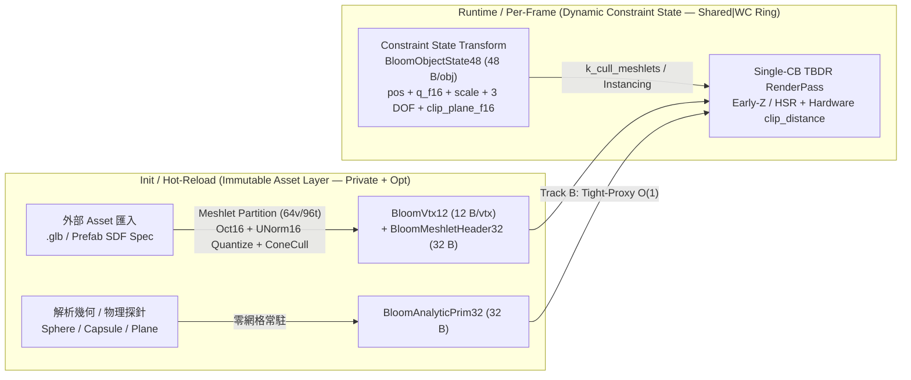

# BLOOM vNext 3D 物件本體研究：Constraint-Native 3D Object SSOT（Apple M1 實測驗證）

> **研究動機（延續 [05_architecture_synthesis.md](file:///Users/kuangtalin/Documents/BLOOM/research/05_architecture_synthesis.md) 決策 #3 討論）**：  
> 當 [07_svg_ssot_fusion.md](file:///Users/kuangtalin/Documents/BLOOM/research/07_svg_ssot_fusion.md) 把 2D UI 拆解為「`init` 編譯期不可變藍圖 + `fnv1a64(id)` 狀態與 20–32 B Refetch 熱流」並實證 4K 12,000 字元僅需 ~1 ms 後，3D 主場景的真正瓶頸已不再只是硬體 API，而是 **「業界 3D 物件規範（glTF / FBX / UE-style `64 B Vertex + 512 B Bone Rig`）把大量可凍結於 `init` 的幾何拓撲、法線空間與約束定義，每一幀重複當成動態串流重算」**。  
> 若把 `FLOW` 已驗證的物理哲學映射到圖形側：**準確的物件本體只在 `init`（匯入 / 烘焙 / 拓撲鎖定）階段發生一次；執行期（Runtime）只在約束投影空間內傳輸低維度狀態變換**，才能同時保住可視化相容性（`.glb` 匯入 + SDF 參數原語）與 M1 統一記憶體 / SLC 物理極限。

---

## §1 範式轉移：與 `07_svg_ssot_fusion.md` 完全同構的 3D Tri-Layer SSOT

與傳統業界規格的本質差異：

| 維度 | 業界標準動態管線 (`.glb` + `Vertex64` + `Skin512`) | BLOOM vNext Constraint-Native 3D Object SSOT |
| :--- | :--- | :--- |
| **幾何真實來源** | 巨大 `64 B/vtx` Vertex Buffer + 每幀 CPU/GPU 乘積 `8 x 4x4` 骨骼矩陣 (`512 B/obj`) | **`init` 烘焙定格**：局部盒 `UNorm16` + 八面體法線 `int8[2]` 壓至 **`12 B/vtx`**；執行期僅傳 **`48 B/obj`** 約束狀態 |
| **精準解析形體** | 二選一：高面數 tessellation 佔 VRAM，或全螢幕 48-step SDF Raymarch (`~54–257 ms`) | **雙軌制**：`Track A` 硬體光柵（複雜曲面）+ **`Track B` Tight-Proxy $O(1)$ 解析求交**（Zero Mesh VRAM） |
| **即時剖切 (Cutaway)** | 重新生成切片網格或片元內 `discard_fragment()`（破壞 M1 TBDR HSR/Early-Z） | State 內建 `clip_plane_f16[4]` 走硬體 **`[[clip_distance]]`**，完整保留 M1 HSR |
| **與 `FLOW` 耦合度** | 若耦合 `FLOW`，圖形層被迫遷就固定點/側車節點布局 | **零 `FLOW` 頭檔依賴**：所有資料純 32-bit 友善佈局，僅於跨子系統橋接時映射狀態向量 |

### 1.1 本探針實證的兩條 M1 Metal 3 C++/MSL 硬體 ABI 鐵律

1. **`ushort3` / `half3` / `half4` 的 MSL 隱式對齊陷阱**：
   Metal Shading Language 中 `ushort3` 佔 **8 B**（非 6 B）、`half3` 佔 **8 B**、`half4` 帶 8 B 對齊，會導致 `BloomVtx12`（12 B）與 `BloomObjectState48`（48 B）在 GPU 端靜默膨脹為 `16 B` / `64 B`。**工程鐵律**：MSL 熱資料結構一律使用純量欄位（`ushort px, py, pz; half sx, sy, sz;`）或 `packed_float*`，並且在 **C++ Host 與嵌入手寫 MSL Shader 兩端同時下 `static_assert(sizeof(...) == N)`**。
2. **Metal 3 `mesh<VertexType, void, ...>` 與 `[[flat]]` 屬性的靜默差異**：
   在 Apple M1 (`Apple7`) 上，若將帶有 `[[flat]]` 修飾的欄位直接放在 `metal::mesh<V, void, ...>` 的 `VertexType`（且 `PrimitiveType = void`），Vertex/Fragment 光柵可正常讀出固定顏色，但 Object+Mesh 管線的 Fragment 階段會讀到未初始化的 Per-Primitive 插槽，導致畫面像素數量雖然 100% 正確（`3,693` 個非零取樣點），色彩雜湊卻在每次執行間跳動（`0x2A65A7FD` / `0x2A086CB6`）。將顏色屬性改為常規逐頂點傳遞（或正式拆入 `PrimitiveType` 透過 `set_primitive()` 寫入）後，`Brute`、`ComputeCull+Indirect` 與 `Metal3 Object+Mesh` 三條管線在 4K 全幅獲得完全一致的決定性雜湊 **`0x08F72CFB`**。

---

## §2 Dual-Track 3D Object SSOT 二進位規格

所有結構定義與實測驅動皆位於零耦合探針 [object_ssot_bench.mm](file:///Users/kuangtalin/Documents/BLOOM/research/probes/object_ssot_bench.mm)：

- **Track A 靜態資產端（`init` 烘焙一次，駐留 `MTLStorageModePrivate`）**：
  - `BloomVtx12` (**12 B**)：`pos_unorm16[3]` (`6 B`, 局部 `[-1.5, +1.5]` 量化精度達 `0.00004 m`) + `oct_norm[2]` (`2 B`, 八面體法線) + `uv_u8[2]` (`2 B`) + `joint_id` (`1 B`) + `mat_id` (`1 B`)。
  - `BloomMeshletHeader32` (**32 B**)：`vtx_offset`, `idx_offset`, `vtx_cnt (<=64)`, `tri_cnt (<=96)`, `obj_id`, `flags`, `bsphere_f16[4]` (視錐剔除球), `cone_axis[3]` + `cone_cutoff` (叢集背面錐剔除), `aabb_scale_tag`。
- **Track B 解析原語與動態狀態端（Runtime 每幀唯寫 `Shared|WriteCombined`）**：
  - `BloomObjectState48` (**48 B**)：`pos[3]` (`12 B`) + `quat_f16[4]` (`8 B`) + `scale_f16[3]` (`6 B`) + `dof_f16[3]` (`6 B` 低維關節自由度) + `rgba8_mat` (`4 B`) + `clip_plane_f16[4]` (`8 B` 即時 X-Ray 剖面) + `flags` (`4 B`)。
  - `BloomAnalyticPrim32` (**32 B**)：`center[3]` + `radius` + `axis_len_f16[4]` + `rgba8` + `prim_kind_flags`，供 Tight-Proxy Billboard + 片元級解析求交（可選 Exact Depth）。

> **外部 `.glb` 匯入定位**：既有的低多邊形 `.glb` 產物（例如 `Games` 工具產出之 watertight mesh）在 `init` 階段僅作為幾何來源，由 Partitioner 切分為 ≤64 頂點 / ≤96 三角形的 Meshlet 並量化為 `BloomVtx12`；Runtime 完全不讀 `.glb` 原始 `64 B` 頂點或 `512 B` Matrix Palette。

---

## §3 Apple M1 4K 實測結果（6 項對照實驗）

測試條件：`object_ssot_bench --json ../build/object_ssot_results.json`，編譯參數 `-std=c++17 -ObjC++ -O3 -Wall -Wextra -fobjc-arc`（0 警告），Metal shader 前先跑 DVFS 暖機並於 4K (`3840x2160`, `BGRA8Unorm` Private+Opt + `Depth32Float` Memoryless) 取穩定中位數與 p95。

| 實驗項目 | 對照基線 (Baseline) | BLOOM vNext 方案 | 關鍵實測數據與倍率 |
| :--- | :--- | :--- | :--- |
| **[1/6] Init 烘焙與資產壓縮** *(16 meshlets, 1,024 vtx, 1,536 tris)* | Industry `GLB64 + u32` `83,968 B` (`21.2 us` bake) | **`BloomVtx12 + Hdr32 + u8`** `13,088 B` (`59.9 us` bake) | **VRAM 縮小 `6.42×`**；位置最大誤差 **`0.00004 m`** (`3.96352e-05 m`)；法線均值 `0.26°` / 最大 `0.64°` |
| **[2/6] Runtime 狀態流 vs 蒙皮** *(2,048 關節物件 / 196,608 tris @ 4K)* | `Industry64 + Rig512` `8.00 MB` (跨 M1 8MB 門檻) WC `1,024.0 KB` / CPU `64.1 us` GPU **`1.389 ms`** (`720.1 fps`, p95 `1.447 ms`) | **`BloomVtx12 + State48`** `1.50 MB` (穩駐 8MB SLC) WC `96.0 KB` / CPU `13.3 us` GPU **`0.381 ms`** (`2,625.7 fps`, p95 `0.388 ms`) | **GPU 加速 `3.65×`**； **WC 頻寬減少 `10.7×`**；CPU 組裝減少 `4.8×` |
| **[3/6] Cluster Cull 三路徑對決** *(4,096 meshlets / 393,216 tris, 60.9% 剔除 @ 4K)* | Brute 全繪製 (4,096 instances): **`0.483 ms`** (`2,068.8 fps`) Metal 3 Object+Mesh Shader: **`0.812 ms`** (`1,232.3 fps`, p95 `0.839 ms`) | **`ComputeCull + Indirect Draw`** (Single-CB, `1,601` 存活): **`0.419 ms`** (`2,388.9 fps`, p95 `0.474 ms`) | 三者決定性雜湊同為 **`0x08F72CFB`** (`150,416,635`)；**M1 (Apple7) 上 ComputeCull+Indirect 比 Metal 3 Object+Mesh 快 `1.94×`** |
| **[4/6] 解析球體三路線** *(256 顆球 @ 4K)* | 48-Step Raymarch Compute: **`54.223 ms`** (`18.4 fps`) 512-Tri 網格 (`70.4 KB` mesh): **`0.364 ms`** (`2,743.6 fps`) | **Tight-Proxy Fast (無改 depth)**: **`0.376 ms`** (`2,661.3 fps`, `8 KB` prim) **Tight-Proxy Exact Depth**: **`0.575 ms`** (`1,738.4 fps`) | 解析球免除所有網格記憶體卻維持 **~`144.3×` vs Raymarch**，僅深度手寫 (disables early-Z) 增 `0.199 ms` |
| **[5/6] 即時動態剖切** *(2,048 重疊物件 Back-to-Front @ 4K)* | No Cutaway (Full HSR): **`0.581 ms`** `discard_fragment()`: **`1.172 ms`** (`853.4 fps`, chk `0x8DC29E98`) | **硬體 `[[clip_distance]]`**: **`0.687 ms`** (`1,455.2 fps`, chk **`0x8DC29E98`**) | 像素輸出與 `discard` 完全一致 (`0x8DC29E98`)，但 **`discard` 慢 `1.71×`**；硬體平面剖切守住 TBDR HSR |
| **[6/6] 4K Single-CB 混合合成** *(1,024 3D 物件/98,304 tris + 64 解析球 + 230 HUD quads + 24 陰影 + 12,000 字形)* | *(對照舊版 v9 全螢幕 4K 軟體式 SDF Raymarch ~257 ms)* | **Single-CB 4K 3D + SVG HUD** WC **`339.2 KB`** / CPU pack **`80.4 us`** GPU **`0.959 ms`** (`1,042.5 fps`, p95 `0.970 ms`) | 單一 CommandBuffer 內 3D 與 SVG HUD 一次深度分區合成，壓在 **`1 ms` 以內** (`chk=0x715B2B09`) |

### 3.1 M1 (Apple7) 架構關鍵結論：為什麼 Compute Cull + Indirect 勝過 Metal 3 Object+Mesh？

實驗 `[3/6]` 實測揭示了一個常被規格書誤導的事實：雖然 Apple M1 已支援 Metal 3 `MTLMeshRenderPipelineDescriptor` 與 `[[object]]`/`[[mesh]]`（實測功能完整且可用），但在 M1 (`Apple7`) 架構上，**Mesh Shader 較高的 threadgroup 排程與 payload 讀寫開銷使其在 393k 幾何負載下耗時 `0.812 ms`，反而慢於粗暴 Draw (`0.483 ms`) 與 `ComputeCull + Indirect` (`0.419 ms`)**。  
更重要的是，`ComputeCull + Indirect Draw` 只需要標準 **Metal Compute + `drawIndexedPrimitives(..., indirectBuffer:)` / WebGPU 等價路徑**，天然與決策 `#1 (Option A: Metal-First + WebGPU gpui_wgpu 同構)` 完全吻合——不需要為了早期 Apple Silicon 上反而較慢的 Mesh Shader 去裂解核心管線。

---

## §4 物理邊界與 BLOOM 3D Object SSOT 語法定義討論

### 4.1 必須明確標註的三條物理邊界（避免過度設計）

1. **動態拓撲變更（破碎、即時布林挖洞大改拓撲）**：無法只改 48 B `BloomObjectState48` 完成，必須觸發局部物件層級的 `re-init`（切分新 Meshlet 並 Async Blit 上傳 `Private` 緩衝），而非回退整幀重建 Vertex Buffer。
2. **高度非線性連續軟組織（例如極限布料摺皺、大型流體表面）**：`dof_f16[3]` 與低維 Modal Projection 僅適合剛體連桿、關節機構與適度振動/屈曲；極高自由度非線性模擬超出「低維約束投影」假設，需走獨立 Compute Vertex Cache/Skinning 通道。
3. **複雜空間折射與二次反彈全域照明**：Track B 的 Tight-Proxy 只在單包絡邊界盒內做 **$O(1)$ 解析求交**（Zero loop marching）；任何依賴多物體迴圈迭代的深層 Raymarch 在 4K 下仍受限於 50+ ms 頻寬/ALU 牆，只適合放在低解析度（Quarter-Res / Half-Res）特效緩衝中。

### 4.2 待與使用者繼續拍板的設計題：BLOOM 3D Object SSOT 原生描述語法

既然後端二進位結構（Track A Meshlet + Track B Tight-Proxy + 48 B Constraint State）已經過 4K `0.959 ms` 實證，接下來決定 **Layer 1 / Toolchain 要用哪種 SSOT 描述檔定義 3D 物件本體**（供繼續討論定案）：

- **方案 3A（推薦，Declarative XML 家族 `<bloom-obj>`）**：延續 `#2 Tri-Layer SVG-SSOT` 與「前端收斂至宣告式 XML」趨勢。靜態 `<asset>` / `<meshlet>` / `<analytic>` 只在 `init` / 熱重載解析，標籤綁定 `id` 與約束向量（`dof`、`clip-plane`、`joint`），天然與 `.svg` 共用同一份 `fnv1a64(id) -> StateStore` 熱更新管線與可視化 Inspector。
- **方案 3B（擴充式 `<bloom-scene>` inside SVG `<foreignObject>` / 自訂命名空間）**：單一檔案直接同時宣告 3D 場景節點與 2D SVG HUD，實現極致單一 SSOT 檔案熱重載，但對 3D 大型 `.glb` Meshlet 二進位段落仍需搭配外部 `.bmesh` Blob（類似 `GLB` JSON+BIN 結構）。
- **方案 3C（極簡 Binary Header + JSON/SVG 清單，`.bobj`）**：主資產走純二進位 Header+Meshlet Stream（零解析延遲），僅由宣告式 Manifest / SVG 綁定約束控制項 ID 與面板。
